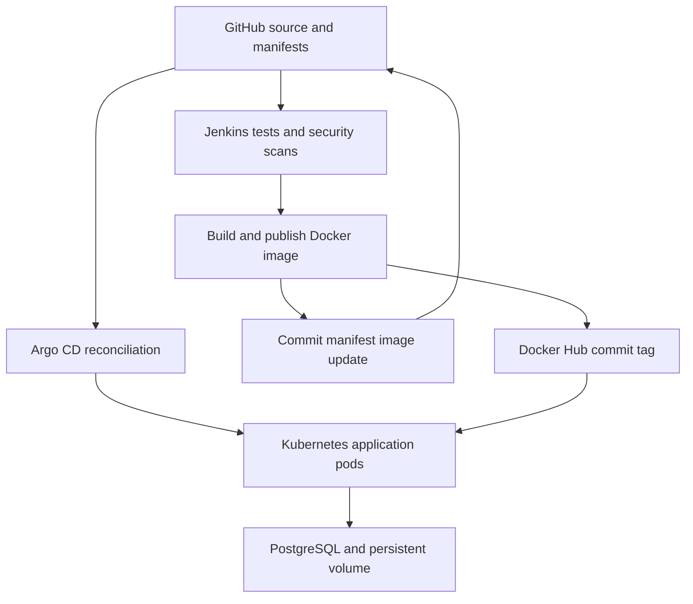

# TaskFlow — DevOps and Automation Capstone

TaskFlow is a small task-management application used to demonstrate a complete DevOps delivery
workflow for a university laboratory: a Python/Flask application with a PostgreSQL database, an
automated test suite, a multi-stage container image, a Jenkins continuous-integration pipeline,
Kubernetes deployment, Terraform and Ansible infrastructure automation, Prometheus/Grafana
monitoring, a centralised ELK logging stack, and a Git-controlled blue-green release.

| | |
| --- | --- |
| **Student** | Arghyadipta Goswami |
| **Roll number** | 2301010192 |
| **Section** | C |
| **Academic year** | 2023–2027 |
| **Subject** | DevOps and Automation |
| **Topic** | Capstone Project |
| **Repository** | [ArghyadiptaGoswami4259/DEV_OPS_LAB_CAPSTONE](https://github.com/ArghyadiptaGoswami4259/DEV_OPS_LAB_CAPSTONE) |
| **Container image name** | `arghyadiptagoswami4259/taskflow` |
| **Evidence date** | 27 November 2026 |

## Submission documents

| Document | Contents |
| --- | --- |
| [Capstone report PDF](docs/Capstone_Report.pdf) | Full submission report with design, implementation and every screenshot |
| [Report in Markdown](REPORT.md) | The same report readable directly on GitHub |
| [Evidence gallery](docs/EVIDENCE.md) | All 23 numbered screenshots with captions |
| [Viva guide](docs/VIVA_GUIDE.md) | Short answers and practice questions |
| [Execution runbook](docs/RUNBOOK.md) | Local startup, infrastructure, CI/CD, monitoring and troubleshooting |
| [Submission checklist](docs/SUBMISSION_CHECKLIST.md) | Upload steps and evidence checks |

## What the application does

The dashboard creates, displays, edits and deletes tasks. Each task has a title, description,
status, priority and timestamps. Users can filter by status and see live task counts. PostgreSQL
stores the data; Flask serves the interface and the JSON API through Gunicorn.

The application also exposes `/health/live`, `/health/ready`, `/api/version` and `/metrics` so the
delivery and monitoring tools can check the running service. Five synthetic tasks can be loaded
once with `SEED_DEMO=1`; no personal dataset is needed.

## DevOps workflow



Jenkins builds a commit-tagged image after the tests and the configured security checks pass, pushes
it to Docker Hub, and commits the new tag to the deployment manifest. Argo CD watches the
`kubernetes/` directory and applies the desired state to the dedicated Minikube cluster. Application
data lives in a PostgreSQL StatefulSet with a 2 GiB persistent volume.

Prometheus and Grafana run in a separate Compose stack. An ELK stack receives a batch of application
logs from Kubernetes for inspection in Kibana. The [runbook](docs/RUNBOOK.md) explains the
connections and the local setup.

## Implemented components

| Area | Implementation |
| --- | --- |
| Application | Python, Flask, Gunicorn, HTML, CSS, JavaScript, PostgreSQL, Psycopg |
| Testing | Pytest unit tests plus API and database integration tests |
| Containers | Multi-stage Dockerfile with separate runtime and test targets; Compose app/database stack |
| Infrastructure | Terraform provisions the dedicated Minikube cluster; Ansible configures namespaces, quotas and limits |
| Kubernetes | Two app replicas, database StatefulSet, Services, ConfigMap, Secret references, probes, 2 GiB PVC |
| Continuous integration | Jenkins: tests, Bandit, pip-audit, Docker build, Trivy report, image push, GitOps update |
| Continuous delivery | Argo CD automatic synchronisation and self-healing; pruning disabled |
| Monitoring | Prometheus scrapes Compose and Kubernetes endpoints; Grafana displays availability and request metrics |
| Logging | Kubernetes log snapshot sent through Logstash to Elasticsearch and viewed in Kibana |
| Release demonstration | Blue and Green deployments; Git-controlled Service selector switch and rollback |

The screenshots and result explanations are in the [report](REPORT.md) and the
[evidence gallery](docs/EVIDENCE.md).

## Quick start for the application

Open Ubuntu in WSL2. Docker Desktop must be running with Ubuntu integration enabled. These commands
start the local Compose application; the full Kubernetes setup is documented separately in the
[runbook](docs/RUNBOOK.md).

```bash
git clone https://github.com/ArghyadiptaGoswami4259/DEV_OPS_LAB_CAPSTONE.git
cd DEV_OPS_LAB_CAPSTONE
```

If the repository is already cloned, use `cd ~/DEV_OPS_LAB_CAPSTONE` instead. Create the local
configuration only when it is absent:

```bash
if [ ! -e .env ]; then
  umask 077
  sed \
    -e "s/^POSTGRES_ADMIN_PASSWORD=$/POSTGRES_ADMIN_PASSWORD=$(openssl rand -hex 24)/" \
    -e "s/^DB_PASSWORD=$/DB_PASSWORD=$(openssl rand -hex 24)/" \
    .env.example > .env
fi

docker compose config --quiet
docker compose up --build -d --wait
docker compose ps
```

Open [TaskFlow](http://localhost:8090). Keep `.env` local. Existing database passwords must keep
matching the roles stored in PostgreSQL; do not regenerate them when resuming the lab.

Run the isolated test suite:

```bash
bash scripts/test.sh
```

The script creates temporary test resources and cleans up its own test volume. It does not use the
application's normal database. Configuration details, sample API calls and native development
instructions are in the [runbook](docs/RUNBOOK.md).

## Local demonstration addresses

| Component | Address | Requirement |
| --- | --- | --- |
| Compose application | http://localhost:8090 | Main Compose stack running |
| Kubernetes application | http://localhost:8091 | Application port-forward running |
| Jenkins | http://localhost:8080 | Jenkins service running |
| Argo CD | https://localhost:8082 | Argo CD port-forward running |
| Prometheus | http://localhost:9090 | Monitoring stack running |
| Grafana | http://localhost:3000 | Monitoring stack running |
| Kibana | http://localhost:5601 | Logging stack running |

These are local demonstration addresses, not public deployment links.

## Repository guide

| Path | Purpose |
| --- | --- |
| `app/`, `wsgi.py`, `gunicorn.conf.py` | Application, interface, metrics and logging |
| `migrations/`, `scripts/01-bootstrap.sql` | Database schema, sample data and role initialisation |
| `tests/`, `scripts/test.sh` | Automated tests and the isolated runner |
| `Dockerfile`, `docker-compose.yml`, `compose.test.yml` | Container build and local execution |
| `Jenkinsfile` | Continuous integration and GitOps image updates |
| `infrastructure/terraform/` | Dedicated Minikube provisioning |
| `infrastructure/ansible/` | Namespace and resource policy configuration |
| `infrastructure/argocd/` | Argo CD Application definition |
| `kubernetes/` | Argo-managed application and database resources |
| `deployment-strategies/blue-green/` | Separate Green deployment manifest |
| `monitoring/`, `logging/` | Prometheus/Grafana and ELK configuration |
| `docs/` | Report, evidence images, viva notes and execution guide |

## Results and scope

The evidence shows a working application image, a passing test suite, validated manifests, the full
CI pipeline definition and the GitOps delivery configuration. The following distinctions matter when
explaining the project:

- Trivy findings are reported without blocking the build. Bandit uses severity and confidence
  thresholds. A successful pipeline does not mean every vulnerability was fixed.
- The database recreation exercise reuses the same PVC. An independent backup and restore is not
  demonstrated.
- Blue-green routing is verified with build identities. Continuous zero-downtime measurement and an
  automatic metrics-triggered rollback are not demonstrated.
- Green is applied from a Git-tracked manifest outside Argo CD's watched directory. Both deployments
  share the database.
- Log forwarding is a batch snapshot, not a streaming collector.
- The application has no login and is intended for a private demonstration. Single-node storage and a
  single database pod do not provide machine-failure high availability.

## Notes for the reviewer

The report PDF, the Markdown report, the evidence gallery and this README were regenerated for this
submission. The screenshots in `docs/evidence/` were captured while re-validating the repository in a
clean Linux environment: every terminal image is the real output of the command shown, and each
configuration image is a rendering of the file in this repository. Hosted dashboards (Jenkins, Argo
CD, Grafana, Kibana) require the local lab to be running; the runbook explains how to open them and
Appendix B of the report explains how to add your own captures of those screens.
