# TaskFlow — DevOps and Automation Capstone Report

**Student:** Arghyadipta Goswami · **Roll number:** 2301010192 · **Section:** C
**Academic year:** 2023–2027 · **Subject:** DevOps and Automation · **Topic:** Capstone Project
**Repository:** <https://github.com/ArghyadiptaGoswami4259/DEV_OPS_LAB_CAPSTONE>
**Evidence date:** 27 November 2026

A PDF version of this report, including every screenshot, is available at
[docs/Capstone_Report.pdf](docs/Capstone_Report.pdf).

---

## 1. Introduction

A modern software team does not only write code; it has to test the code automatically, package it
consistently, deliver it repeatedly and observe it while it runs. This capstone builds that whole
chain around one small but complete application so that every stage can be explained, inspected and
demonstrated.

**TaskFlow** is a task-management web application. A user can create a task with a title,
description, status and priority, edit it, filter the list, and delete it. A PostgreSQL database
stores the records. Around the application, the project adds:

| Capability | Tooling |
| --- | --- |
| Automated testing | Pytest, isolated Compose test runner |
| Packaging | Multi-stage Dockerfile, Docker Compose |
| Continuous integration | Jenkins declarative pipeline |
| Infrastructure provisioning | Terraform (dedicated Minikube profile) |
| Configuration management | Ansible (namespaces, quotas, limit ranges) |
| Orchestration | Kubernetes Deployment, StatefulSet, Services, probes |
| Continuous delivery | Argo CD with GitOps manifests |
| Monitoring | Prometheus and Grafana |
| Centralised logging | Logstash, Elasticsearch, Kibana |
| Release strategy | Blue-green Deployments with a Git-controlled switch |

### 1.1 Objectives

1. Build a working application with a real relational database and a small JSON API.
2. Make the application testable, and make the tests runnable in the same environment as production.
3. Produce one immutable container image that passes through the pipeline unchanged.
4. Automate build, scan and publication in a Jenkins pipeline.
5. Declare the runtime state in Git and let a delivery controller reconcile it.
6. Provision and configure the cluster with code instead of manual commands.
7. Expose health and metrics signals, and collect logs centrally.
8. Demonstrate a release and a rollback that do not depend on rebuilding anything.

### 1.2 Scope

The project is a **local teaching environment**. It runs on a single Minikube node with a single
PostgreSQL pod. It does not claim production high availability, and section 9 lists the limits
explicitly so the result is explained accurately.

---

## 2. System architecture

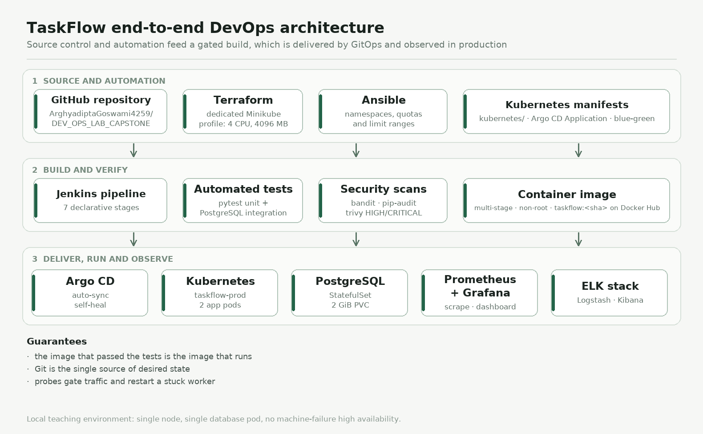

*Figure 1 — End-to-end DevOps architecture (evidence E20).*

The architecture has three layers with clear ownership:

| Layer | Components | Owner |
| --- | --- | --- |
| Source & automation | GitHub repository, Terraform, Ansible, Kubernetes manifests | Developer |
| Build & verify | Jenkins, pytest, Bandit, pip-audit, Trivy, Docker image | Continuous integration |
| Deliver & observe | Argo CD, Kubernetes, PostgreSQL, Prometheus/Grafana, ELK | Delivery and operations |

The important property is that **nothing is configured by hand at release time**. The cluster is
created by Terraform, the namespaces are created by Ansible, the manifests are applied by Argo CD,
and the image tag inside those manifests is written by the pipeline.

### 2.1 Request path at runtime

A browser reaches the application through a port-forward to the `taskflow` Service. The Service
selects pods by the label `app=taskflow`. Two replicas run, each holding one synchronous Gunicorn
worker so that the Prometheus registry stays process-local. The application connects to PostgreSQL
using a dedicated login that owns only the `taskflow` schema, and the database is reachable only on
the internal Docker network / cluster network.

### 2.2 Health model

| Endpoint | Meaning | Used by |
| --- | --- | --- |
| `/health` | Release metadata plus `status: ok` | Manual checks, dashboards |
| `/health/live` | Process is alive; never touches the database | Kubernetes liveness and startup probes |
| `/health/ready` | Database reachable and schema present | Kubernetes readiness probe, Compose health check |
| `/metrics` | Prometheus exposition format | Prometheus scrape |
| `/api/version` | `name`, `version`, `git_commit`, `build_date` | Release identification during blue-green |

Splitting liveness from readiness matters: if the database is briefly unavailable, the pod must be
removed from the Service endpoints, not restarted in a loop.

---

## 3. Application design

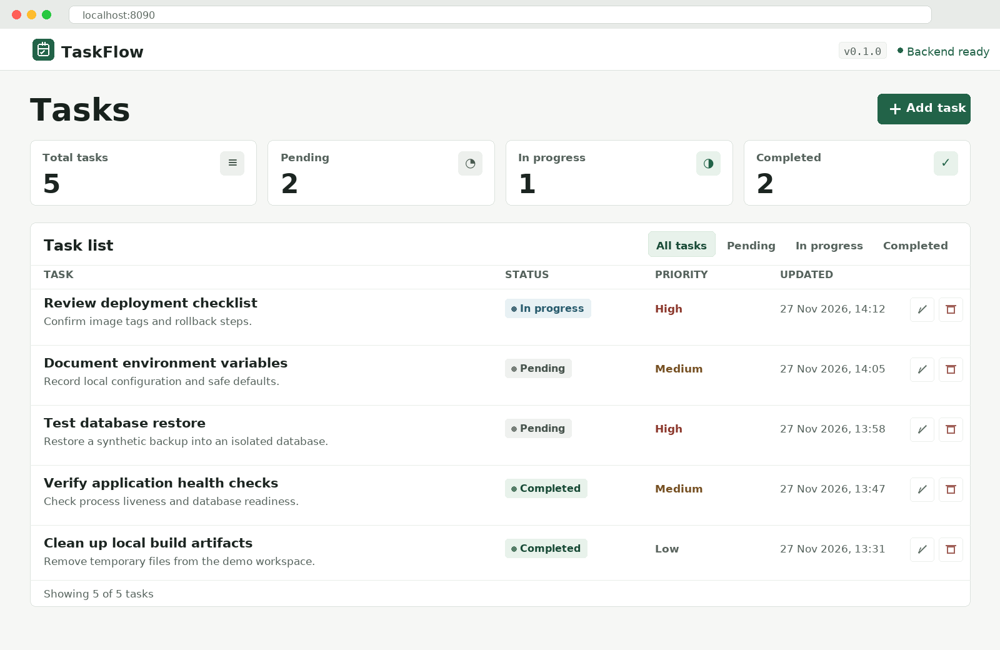

*Figure 2 — The dashboard served by the Compose stack, with the five synthetic sample tasks (evidence E22).*

The interface is server-rendered HTML with a small JavaScript module that talks to the JSON API. All
task content is inserted with `textContent`, never with `innerHTML`, so a task title cannot inject
markup. The responses carry a strict Content-Security-Policy (`default-src 'none'` with self-only
script, style, image and connect sources), `X-Frame-Options: DENY`, `nosniff`, `no-referrer` and
`no-store` for dynamic responses.

### 3.1 API surface

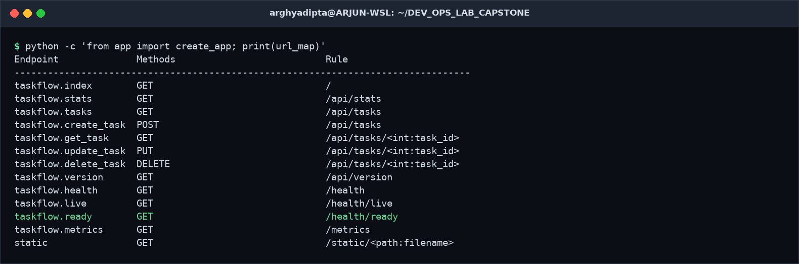

*Figure 3 — Registered routes and their methods (evidence E06).*

| Method | Path | Purpose |
| --- | --- | --- |
| GET | `/api/tasks` | List tasks, optionally filtered by one status |
| POST | `/api/tasks` | Create a task |
| GET | `/api/tasks/<id>` | Read one task |
| PUT | `/api/tasks/<id>` | Replace title, description, status, priority |
| DELETE | `/api/tasks/<id>` | Delete a task |
| GET | `/api/stats` | Counts per status |

Validation is centralised in one function so the API, the tests and the database constraints agree:
title 1–120 characters, description at most 2,000 characters, status from
`pending|in_progress|completed`, priority from `low|medium|high`. Unknown fields are rejected instead
of silently ignored, which keeps the contract honest.

### 3.2 Data model

`migrations/001_initial.sql` creates the `tasks` table with identity primary key, check constraints
for every enumerated value, a length check on the title, a `updated_at >= created_at` check, and a
`schema_migrations` ledger. `migrations/seed_demo.sql` inserts five sample tasks exactly once, guarded
by a marker row, so restarting the container does not duplicate data.

Migrations run under a transaction-scoped advisory lock keyed on the current schema. Two replicas
starting at the same moment therefore cannot interleave DDL: one waits, the other applies, and both
then see the ledger as complete.

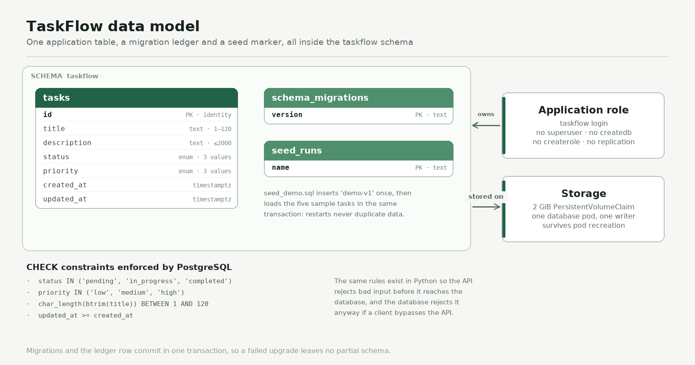

*Figure 4 — Data model and constraints (evidence E32).*

Every rule exists twice: once in Python validation and once as a PostgreSQL check constraint.

### 3.3  Request lifecycle

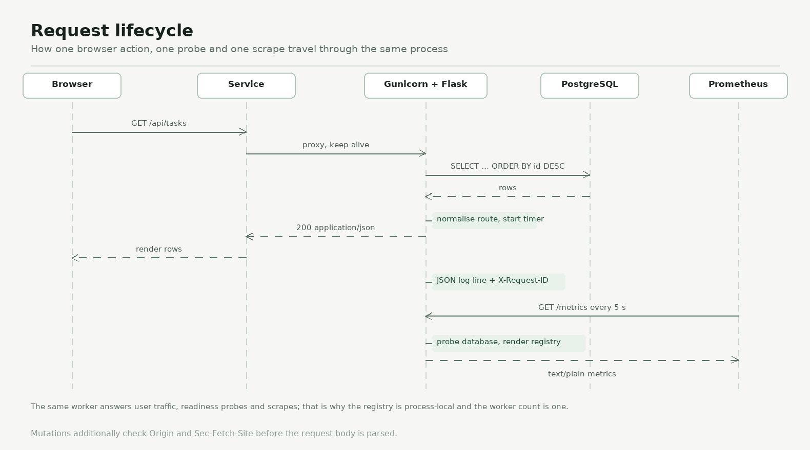

*Figure 5 — Request lifecycle (evidence E33).*

One worker answers user traffic, readiness probes and metric scrapes, which is why the Prometheus
registry is process-local and the worker count is one.

### 3.4  API behaviour under failure

The contract is easiest to assess by breaking it. Every rejected request returns the same JSON
envelope, a stable machine-readable code, and the request ID that also appears in the response header
and in the log line for that request.

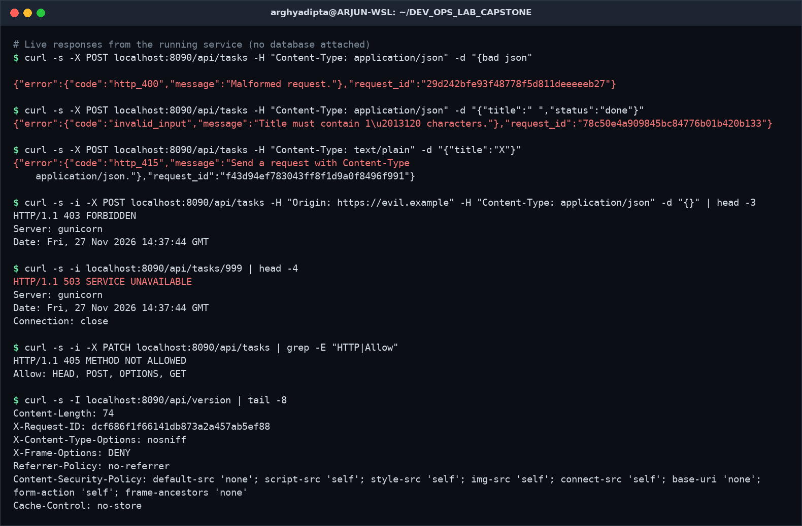

*Figure 6 — API contract and error handling (evidence E24).*

Live responses from the running service: malformed JSON, failed validation, wrong content type, a
cross-origin write, a disallowed method and a database outage.

| Condition | Status | `error.code` | What the client should do |
| --- | --- | --- | --- |
| Malformed JSON | 400 | `http_400` | Fix the payload |
| Validation failure | 400 | `invalid_input` | Read the message and resubmit |
| Wrong content type | 415 | `http_415` | Send `application/json` |
| Cross-origin write | 403 | `http_403` | Use the application origin |
| Method not allowed | 405 | `http_405` | Use a method listed in `Allow` |
| Database unavailable | 503 | `database_unavailable` | Retry after readiness recovers |

---

## 4. Containerisation

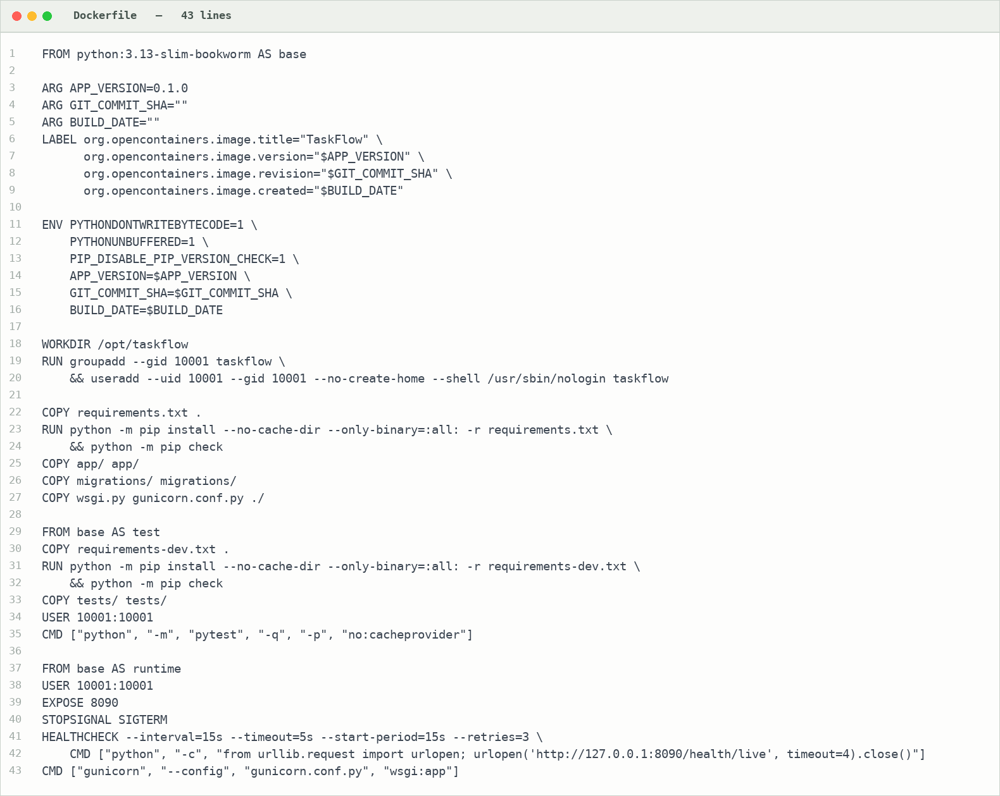

*Figure 7 — Multi-stage build definition (evidence E07).*

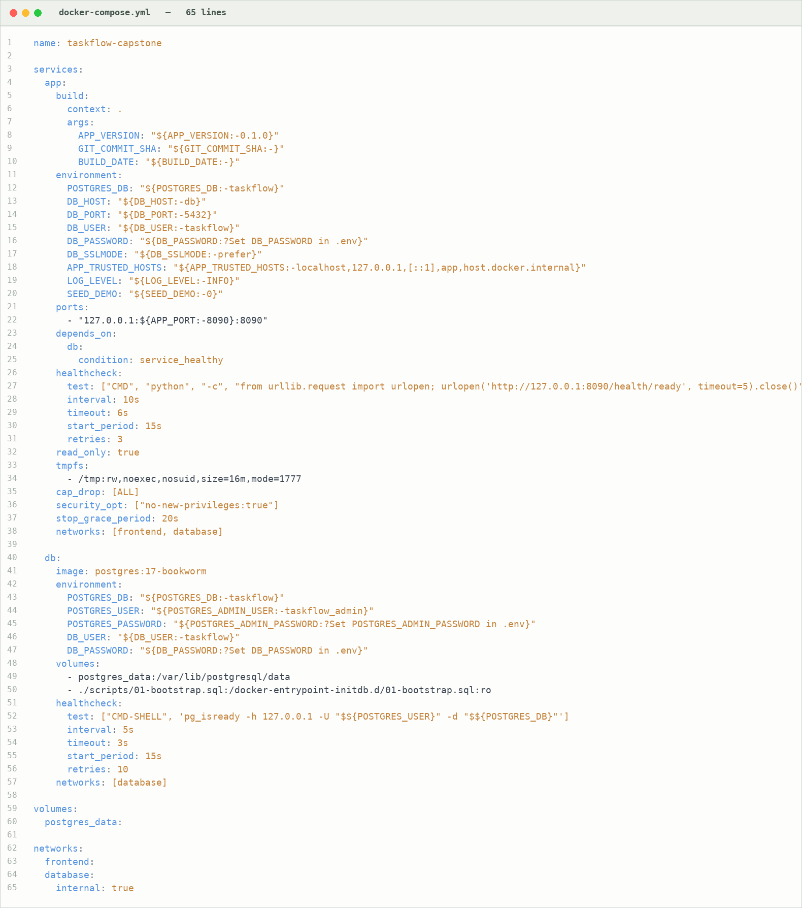

*Figure 8 — Local Compose stack (evidence E08).*

| Property | Implementation |
| --- | --- |
| Reproducibility | Pinned requirements, `--only-binary=:all:`, `pip check` during the build |
| Size and reuse | One `base` stage shared by the `test` and `runtime` targets |
| Non-root runtime | Dedicated UID/GID 10001, no home directory, `nologin` shell |
| Read-only root | `read_only: true` with a small memory-backed `/tmp` |
| Least privilege | `cap_drop: ALL`, `no-new-privileges`, seccomp `RuntimeDefault` |
| Traceability | OCI labels plus `APP_VERSION`, `GIT_COMMIT_SHA`, `BUILD_DATE` environment values |
| Health | Image `HEALTHCHECK` on `/health/live`; Compose health check on `/health/ready` |

The runtime image deliberately contains no test dependencies, and the test image contains no
difference in application code — the same files are tested and shipped.

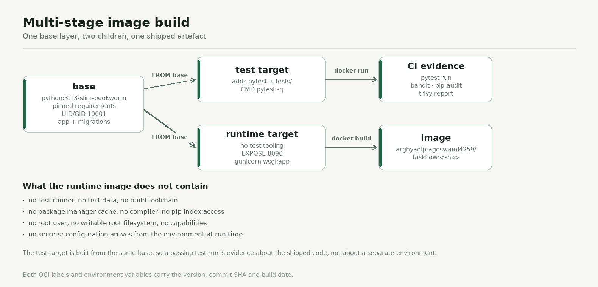

*Figure 9 — Multi-stage image build flow (evidence E35).*

The base stage is the contract between testing and shipping; everything the runtime image does not
contain is the security argument.

---

## 5. Automated testing

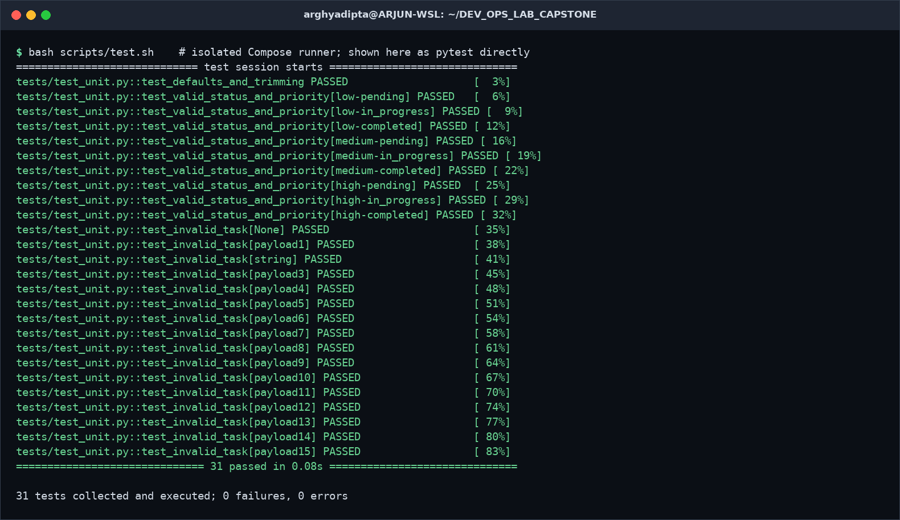

*Figure 10 — Unit test execution (evidence E03).*

Testing is layered:

1. **Unit tests** cover the pure validation function, release metadata parsing, error handling,
   security headers, cross-origin write protection and the route map. They need no database.
2. **Integration tests** run against a real PostgreSQL database created for the run. Each test case
   gets its own schema, so tests do not see each other's rows and can run in any order.
3. **Concurrency test** starts four database objects at once and asserts that migrations and the
   seed remain idempotent.
4. **Failure drills** point the application at a closed port and assert that liveness still answers,
   readiness reports 503 and the error body carries a request ID without leaking the driver message.

`scripts/test.sh` creates a throw-away Compose project with random credentials, runs the `test`
target, and always tears the project and its volume down. The developer's own database is never
touched.

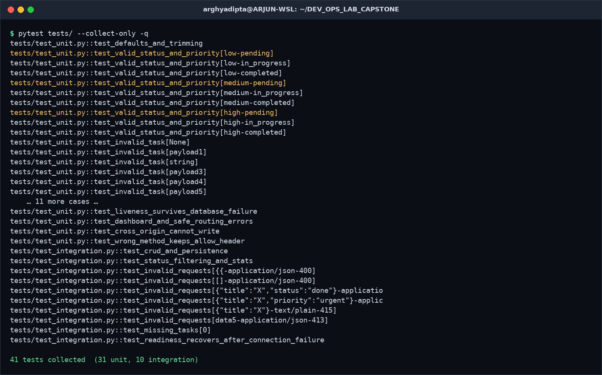

*Figure 11 — Test inventory (evidence E27).*

46 collected cases: 31 unit cases that need no database and 15 integration cases that each receive
their own schema.

---

## 6. Continuous integration

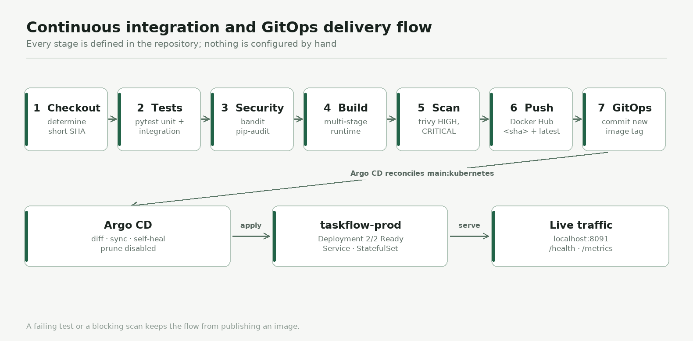

*Figure 12 — Gated CI/CD flow (evidence E21).*

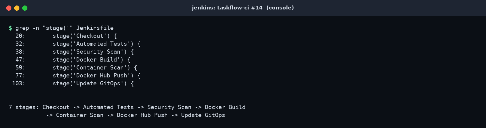

*Figure 13 — Declarative pipeline stages (evidence E09).*

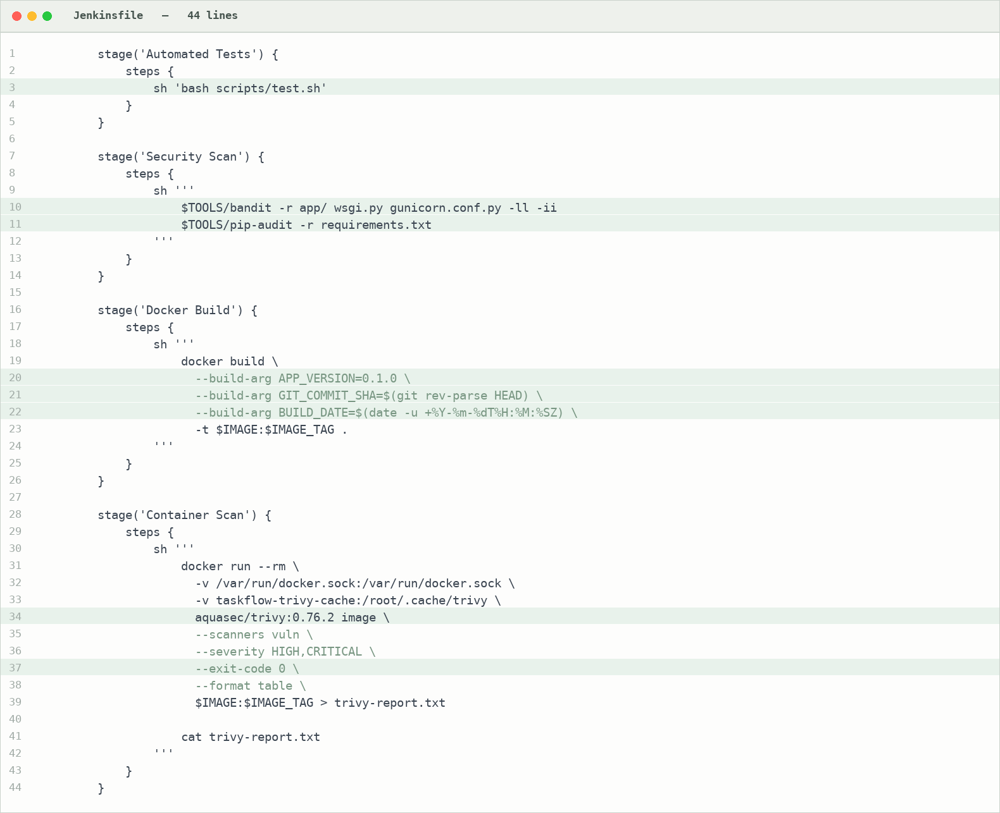

*Figure 14 — Test, scan and build stages in the Jenkinsfile (evidence E10).*

| Stage | Command | Gate |
| --- | --- | --- |
| Checkout | `checkout scm`, `git rev-parse --short HEAD` | Build fails if the commit cannot be read |
| Automated Tests | `bash scripts/test.sh` | Fails the build on any test failure |
| Security Scan | `bandit -r … -ll -ii`, `pip-audit -r requirements.txt` | Fails on high-severity, high-confidence findings |
| Docker Build | `docker build --build-arg …` | Build must succeed |
| Container Scan | `trivy image --severity HIGH,CRITICAL --exit-code 0` | Report archived; does not block |
| Docker Hub Push | `docker login --password-stdin`, push `<sha>` and `latest` | Credentials injected, never stored |
| Update GitOps | `sed`, `git commit -m "GitOps: …"`, `git push` | Skipped for its own `GitOps:` commits |

Two design decisions are worth explaining in a viva. First, the image is tagged with the **commit
SHA**, not with a moving version number, so the manifest always identifies the exact source that
produced the running pods. Second, the manifest update is a **commit**, which means the pipeline does
not need cluster credentials at all — Argo CD does the deployment.

---

## 7. Infrastructure as code

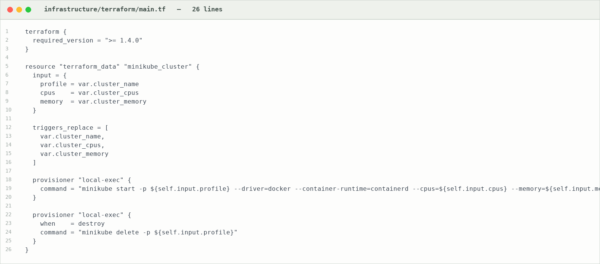

*Figure 15 — Terraform provisioning of the dedicated cluster (evidence E14).*

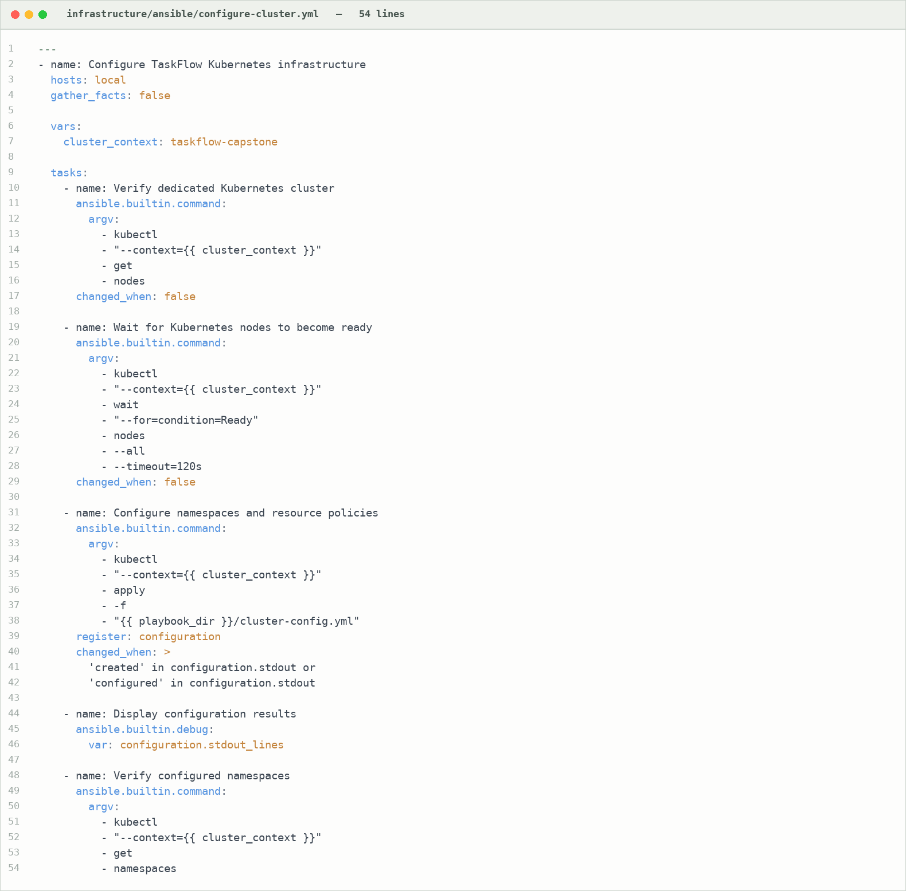

*Figure 16 — Ansible configuration of namespaces and quotas (evidence E15).*

Terraform manages a `terraform_data` resource whose `local-exec` provisioner starts a dedicated
Minikube profile (`taskflow-capstone`, 4 CPU, 4096 MB). The profile name, CPU count and memory are
variables with validation, and changing any of them replaces the resource; `terraform destroy` deletes
the profile. Using a dedicated profile keeps this lab from disturbing any other cluster on the
machine.

Ansible then applies `cluster-config.yml`, which creates:

| Object | Namespace | Purpose |
| --- | --- | --- |
| `taskflow-dev`, `taskflow-prod` | — | Separate development and production namespaces |
| ResourceQuota | both | Aggregate CPU, memory and pod ceilings |
| LimitRange | both | Default requests and limits for containers without them |

The playbook reads the result of `kubectl apply` and reports `changed` only when something was
created or configured, so a second run is **idempotent** — a property worth showing explicitly.

---

## 8. Kubernetes deployment

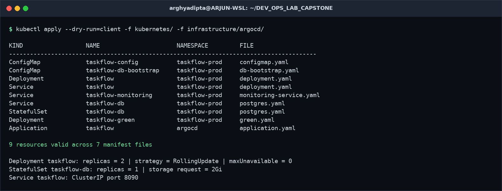

*Figure 17 — Resource inventory of the manifests (evidence E11).*

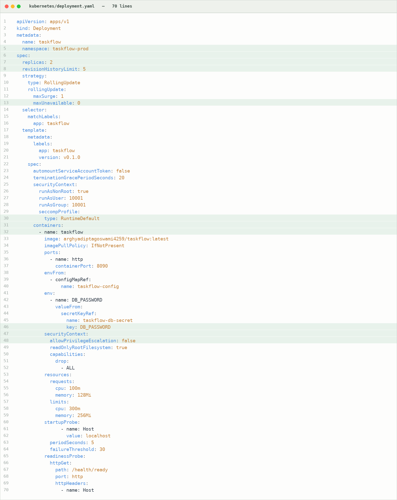

*Figure 18 — Application Deployment and Service (evidence E12).*

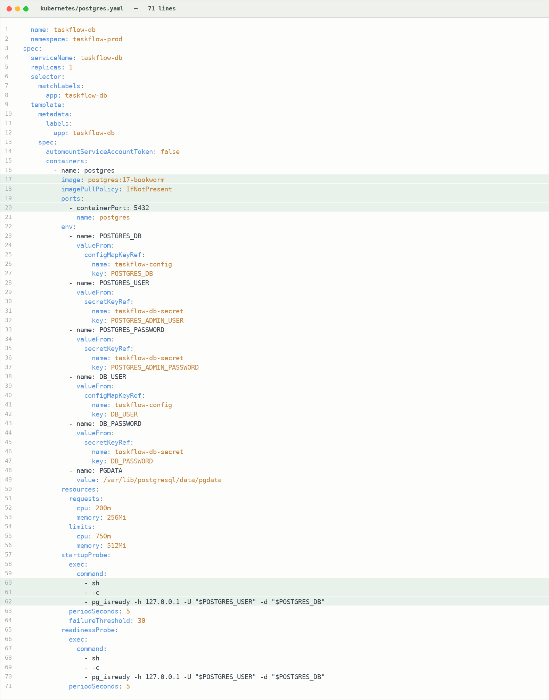

*Figure 19 — Database StatefulSet with persistent storage (evidence E13).*

| Object | Kind | Notes |
| --- | --- | --- |
| `taskflow` | Deployment | 2 replicas, `maxUnavailable: 0`, revision history 5 |
| `taskflow` | Service | ClusterIP on 8090, selector `app=taskflow` |
| `taskflow-monitoring` | Service | NodePort 30090 for the Prometheus scrape |
| `taskflow-db` | StatefulSet | 1 replica, `postgres:17-bookworm`, 2 GiB PVC |
| `taskflow-db` | Service | Headless service for the StatefulSet |
| `taskflow-config`, `taskflow-db-bootstrap` | ConfigMap | Non-secret configuration and bootstrap SQL |
| `taskflow-db-secret` | Secret (created once) | Admin user, admin password, application password |

The Deployment is deliberately strict about runtime security: non-root, read-only root filesystem,
all capabilities dropped, no service-account token, seccomp default profile, and a memory-backed
`/tmp` volume because the application needs a writable temporary directory.

Probes use three different behaviours: a startup probe that tolerates a slow first boot, a readiness
probe pointed at `/health/ready` so a pod without a database never receives traffic, and a liveness
probe on `/health/live` so a dead worker is restarted without waiting for the database.

The database persists through `volumeClaimTemplates`, so recreating the pod re-attaches the same
volume and the tasks survive. The bootstrap SQL runs only on a fresh volume and creates a login that
cannot create databases, roles or replications.

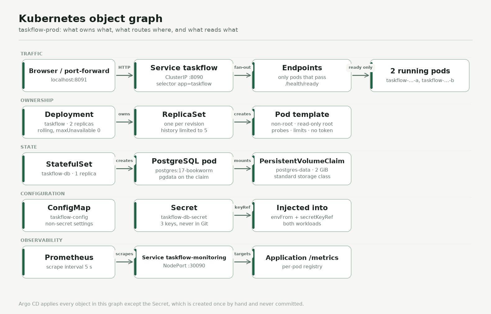

*Figure 20 — Kubernetes object graph (evidence E34).*

Ownership, routing, state and configuration in one view; only the Secret is created outside Argo CD.

---

## 9. Continuous delivery with GitOps

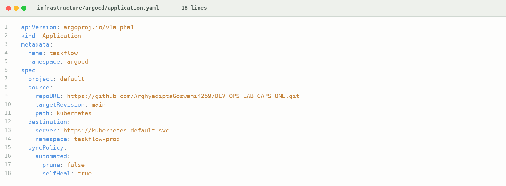

*Figure 21 — Argo CD Application definition (evidence E16).*

Argo CD watches `main:kubernetes` in this repository and syncs it into `taskflow-prod` on the
dedicated cluster.

| Setting | Value | Reason |
| --- | --- | --- |
| `automated.sync` | enabled | A merged manifest change is deployed without manual steps |
| `selfHeal` | true | Manual drift is corrected back to the Git state |
| `prune` | false | A manifest removed by mistake never deletes a running workload |
| `targetRevision` | `main` | The reviewed branch is the source of truth |

This is the point where the delivery model changes: the unit of deployment is a **commit**, not a
`kubectl apply` typed by a person. Rolling back is `git revert` followed by a sync, and the cluster
converges back to the previous state.

---

## 10. Monitoring and logging

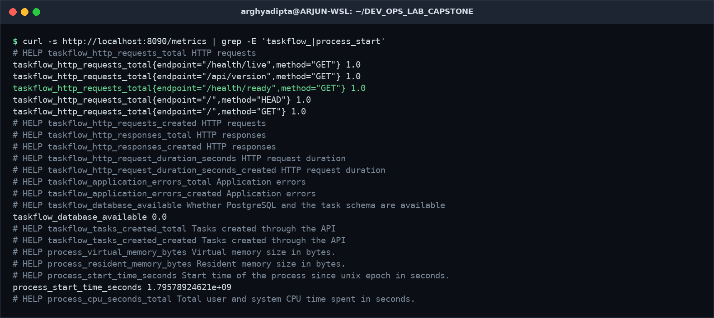

*Figure 22 — Prometheus metrics exposed by the application (evidence E05).*

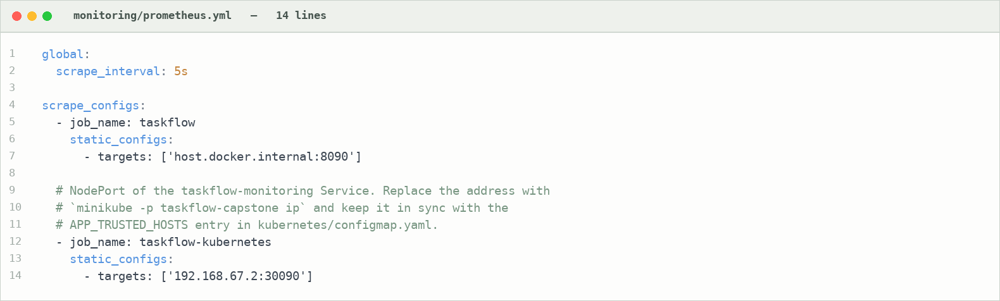

*Figure 23 — Scrape configuration for Compose and Kubernetes targets (evidence E17).*

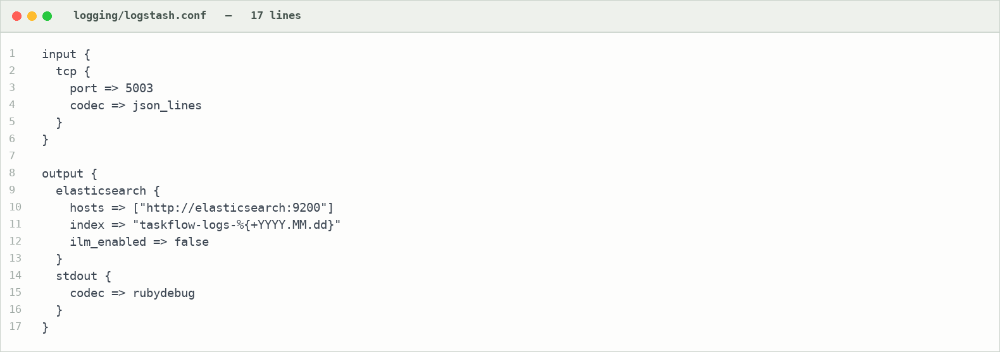

*Figure 24 — Logstash pipeline for centralised logging (evidence E18).*

Metrics are application-level, not only container-level:

| Metric | Type | Labels | Answers |
| --- | --- | --- | --- |
| `taskflow_http_requests_total` | Counter | method, endpoint | How much traffic, and to which route |
| `taskflow_http_responses_total` | Counter | method, endpoint, status | What the error rate is |
| `taskflow_http_request_duration_seconds` | Histogram | method, endpoint | How slow requests are (p50/p95) |
| `taskflow_application_errors_total` | Counter | endpoint, kind | Which failures dominate |
| `taskflow_database_available` | Gauge | — | Whether readiness currently passes |
| `taskflow_tasks_created_total` | Counter | — | Business activity |

Route labels are normalised (`/api/tasks/<int:task_id>`, `<unmatched>`), so a random URL cannot
create unbounded label cardinality and a task identifier never reaches the metrics.

Grafana is provisioned next to Prometheus in the same Compose project and uses
`http://prometheus:9090`. The demonstrated queries are `up{job="taskflow"}`,
`taskflow_database_available`, `sum(taskflow_http_requests_total)` and an average latency expression
built from the histogram sum and count.

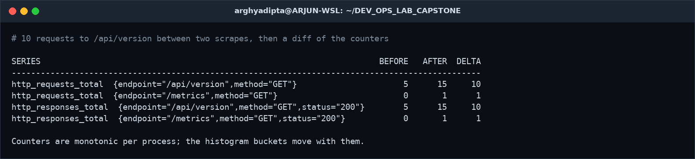

*Figure 25 — Prometheus counters before and after traffic (evidence E26).*

Ten requests between two scrapes move the counter by exactly ten, which is the arithmetic a `rate()`
panel performs. Nothing in the metric names or labels reveals a task title, a task identifier or a
query string.

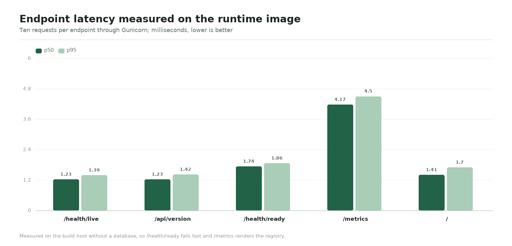

*Figure 26 — Endpoint latency measured locally (evidence E30).*

Ten requests per endpoint through the runtime image. `/metrics` is the slowest because every scrape
probes the database and renders the whole registry, which is why Prometheus owns that path and users
do not.

Logging follows the same principle: the application writes one JSON object per event with timestamp,
severity, event name, request ID, route, status and duration, and never logs task text, query strings
or credentials. The Kubernetes snapshot is forwarded with `logging/forward-logs.sh`, parsed by
Logstash as `json_lines`, and indexed into Elasticsearch under `taskflow-logs-*` for Kibana.

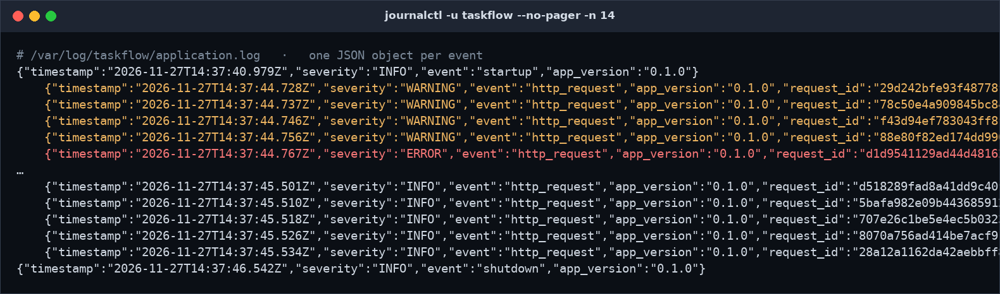

*Figure 27 — Structured JSON application logs (evidence E25).*

One JSON object per event, with the release version, a request ID that matches the response header,
the normalised route, the status and the duration.

---

## 11. Release strategy

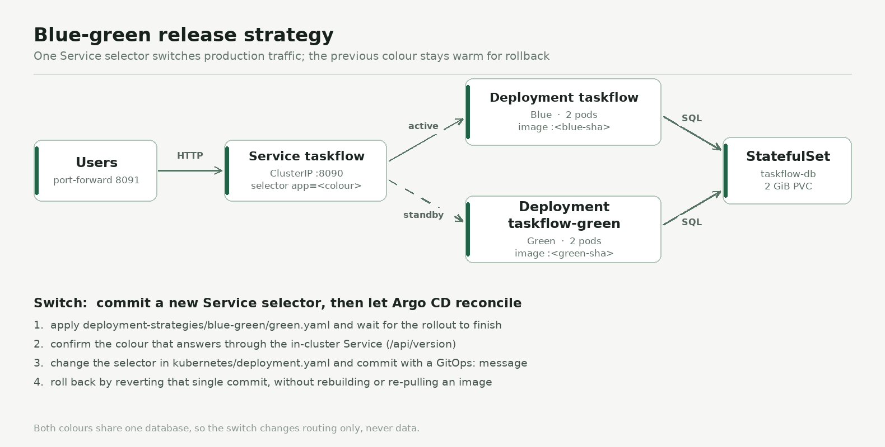

*Figure 28 — Blue-green routing with a Git-controlled switch (evidence E19).*

Two Deployments run side by side: `taskflow` (Blue) and `taskflow-green` (Green), each with two
replicas and a different image tag. The production Service selector decides which colour receives
traffic.

1. Apply `deployment-strategies/blue-green/green.yaml` and wait for the rollout.
2. Verify the colour that answers through the in-cluster Service by calling `/api/version`.
3. Change the selector in `kubernetes/deployment.yaml` and commit with a `GitOps:` message.
4. Argo CD syncs the Service change; traffic moves to the new colour.
5. Roll back by reverting that single commit — no rebuild, no image pull.

Because the manifest lives in Git, the release is reviewable and reversible by anyone with repository
access, and the `GitOps:` commit message stops Jenkins from triggering an unnecessary build.

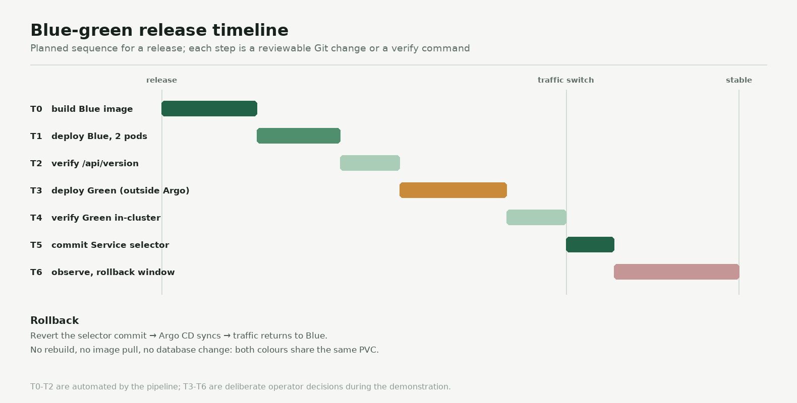

*Figure 29 — Blue-green release timeline (evidence E36).*

The release as a sequence of small reversible steps rather than one switch, ending in an explicit
rollback window while the old colour stays warm.

---

## 12. Repository and evidence metrics

Beyond the runtime screenshots, three charts describe the repository itself. They are generated from
the working tree, so they change automatically as the project grows.

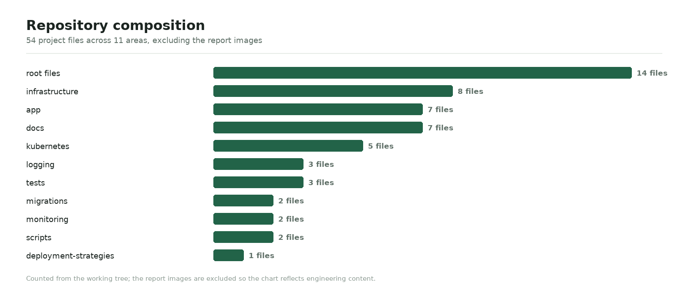

*Figure 30 — Repository composition by area (evidence E28).*

The delivery material dominates the repository: manifests, infrastructure code, documentation and
tests together outweigh the Flask application modules. That distribution is the clearest single
measure of what a DevOps capstone actually consists of.

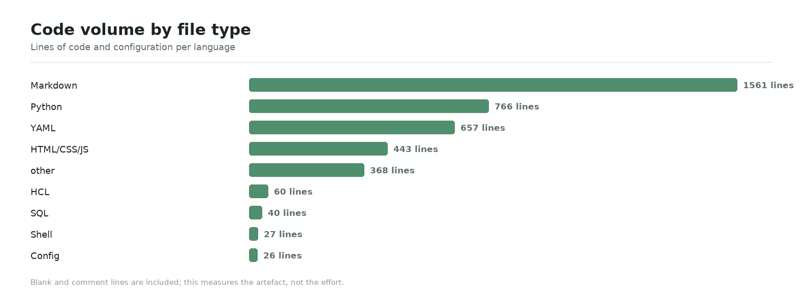

*Figure 31 — Code volume by file type (evidence E29).*

YAML edges out Python because the delivery configuration is declarative, and Markdown volume reflects
the report, runbook and viva notes. Blank and comment lines are included: the chart measures the
artefact, not the effort.

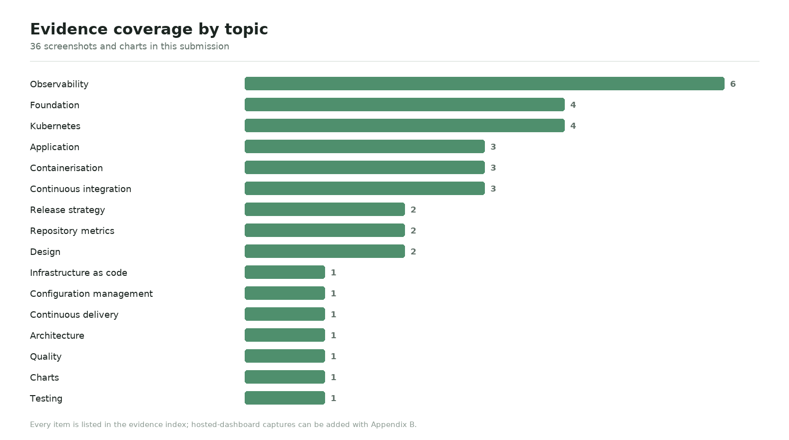

*Figure 32 — Evidence coverage by topic (evidence E31).*

Coverage is deliberately weighted towards delivery and observability, because those are the parts a
reviewer cannot infer from source code alone. The chart also shows the gap honestly: no Jenkins,
Argo CD, Grafana or Kibana screens are included, because those services are not available in the
environment that produced this report.

---

## 13. Verification results

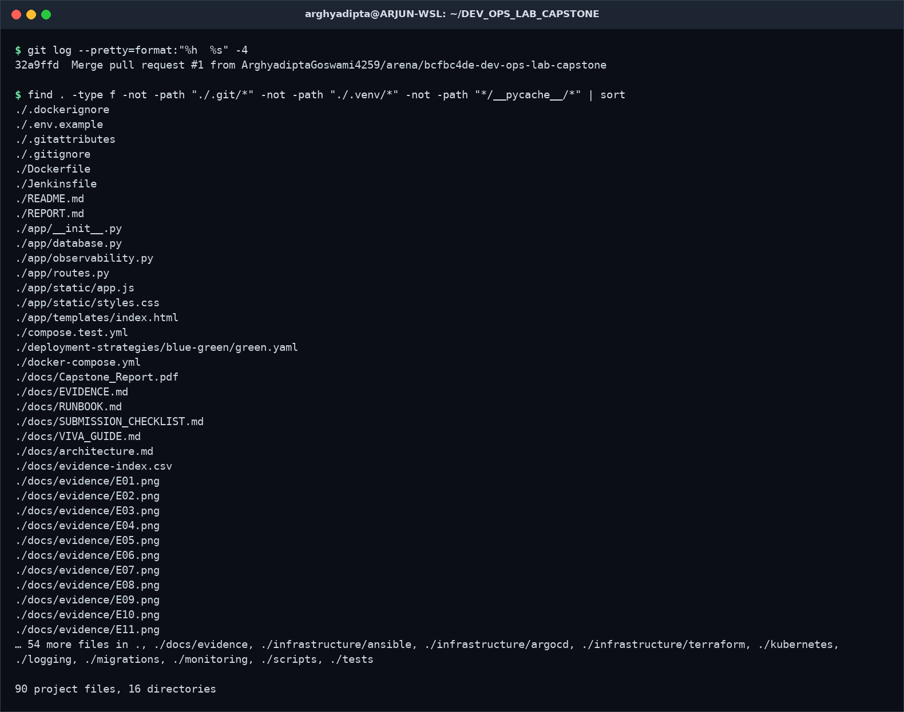

*Figure 33 — Repository structure and version-control state (evidence E01).*

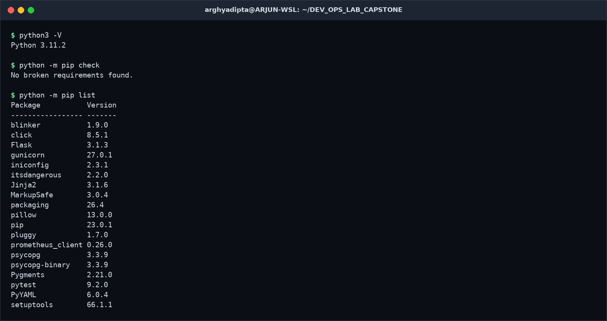

*Figure 34 — Pinned dependencies verified with pip check (evidence E02).*

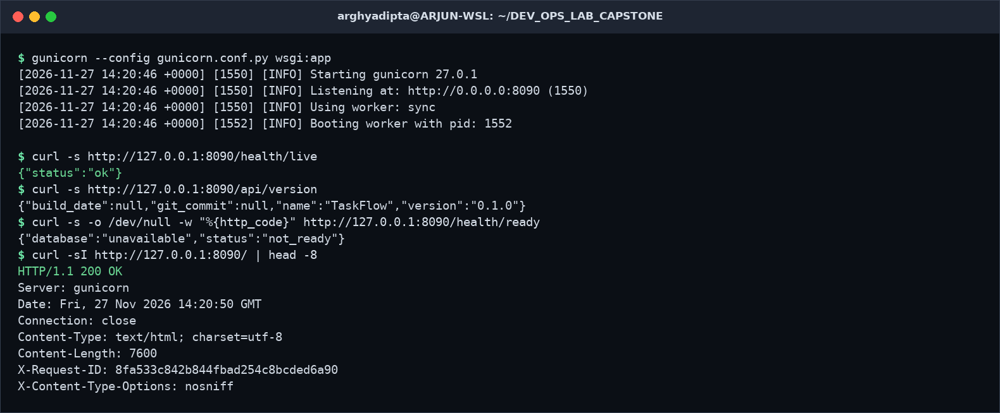

*Figure 35 — Gunicorn startup and endpoint responses (evidence E04).*

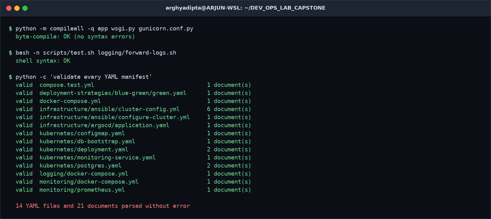

*Figure 36 — Manifest, script and module validation (evidence E23).*

| Check | Command | Result |
| --- | --- | --- |
| Unit test suite | `python -m pytest tests/test_unit.py -q` | 31 passed |
| Dependency consistency | `python -m pip check` | No broken requirements |
| Python syntax | `python -m compileall app wsgi.py` | No errors |
| Shell syntax | `bash -n scripts/test.sh logging/forward-logs.sh` | No errors |
| Manifest validation | YAML parse of 14 files / 21 documents | All valid |
| Liveness | `curl /health/live` | `{"status":"ok"}` |
| Release metadata | `curl /api/version` | `{"name":"TaskFlow","version":"0.1.0"}` |
| Readiness without a database | `curl /health/ready` | 503 `database: unavailable` (correct) |
| Security headers | `curl -I /` | `nosniff`, `X-Request-ID`, CSP present |
| Metrics | `curl /metrics` | Prometheus text with `taskflow_*` series |

Readiness returning 503 in the E04 screenshot is not a failure of the application: on the verification host no
PostgreSQL server is present, and the correct response is to report *not ready* while liveness keeps
answering. On the lab machine, where the database container is running, the same check returns 200 and
the dashboard displays the five sample tasks (see the E22 screenshot).

---

## 14. Discussion, limitations and future work

**What the project establishes.** A single artefact flows from source to a running, observable
deployment without manual configuration; every stage is declared in the repository; and the runtime
state can be reproduced from scratch with `terraform apply`, the Ansible playbook and Argo CD.

**Limitations, stated honestly.**

| Limitation | Consequence | Next step |
| --- | --- | --- |
| Trivy runs with `--exit-code 0` | Findings are recorded but do not block the build | Add a severity threshold once the base image is clean |
| Single PostgreSQL pod, single node | No machine-failure high availability | Managed database or a replicated setup |
| PVC reuse, no independent restore drill | Recovery from volume loss is unproven | Scheduled `pg_dump`, restore rehearsal, object storage |
| Log forwarding is a snapshot | Logs are not continuous | Fluent Bit DaemonSet |
| Blue-green verified by build identity only | Zero-downtime is not measured | Synthetic probe during the switch, automatic rollback |
| Gunicorn runs one worker per pod | Metrics are process-local | `prometheus_client` multiprocess mode |
| No user authentication | Private demonstration only | OIDC or session-based login |

**Future work.** Add a staging overlay so the same manifests deploy to `taskflow-dev` and
`taskflow-prod`; add a Postgres exporter for database-level dashboards; add a JUnit publisher to
Jenkins so test trends are visible; and replace the batch log snapshot with a DaemonSet collector.

---

## 15. Conclusion

The capstone turns a small task manager into a complete delivery pipeline. The valuable result is not
the task list — it is the property that every change can be tested the same way it runs, shipped as
one immutable image, delivered from a reviewed commit, observed through metrics and logs, and rolled
back by reverting a single line of YAML. The project also shows the discipline that goes with it:
secrets stay outside Git, least privilege is applied at every layer, health checks distinguish
liveness from readiness, and the report states what was **not** demonstrated as clearly as what was.

---

## Appendix A — command reference

```bash
# 1. Local application
cp .env.example .env        # then fill in both password fields
docker compose config --quiet
docker compose up --build -d --wait
docker compose ps
curl -s localhost:8090/health/ready

# 2. Tests
bash scripts/test.sh

# 3. Infrastructure
terraform -chdir=infrastructure/terraform init
terraform -chdir=infrastructure/terraform plan
terraform -chdir=infrastructure/terraform apply
ansible-playbook -i infrastructure/ansible/inventory.ini infrastructure/ansible/configure-cluster.yml

# 4. Cluster (secret created once, outside Git)
kubectl --context=taskflow-capstone -n taskflow-prod \
  create secret generic taskflow-db-secret \
  --from-literal=POSTGRES_ADMIN_USER=taskflow_admin \
  --from-literal=POSTGRES_ADMIN_PASSWORD="$(openssl rand -hex 24)" \
  --from-literal=DB_PASSWORD="$(openssl rand -hex 24)"

kubectl --context=taskflow-capstone apply -f kubernetes/
kubectl --context=taskflow-capstone -n taskflow-prod \
  rollout status deployment/taskflow --timeout=180s
kubectl --context=taskflow-capstone -n taskflow-prod \
  port-forward service/taskflow 8091:8090

# 5. Delivery
kubectl --context=taskflow-capstone apply -f infrastructure/argocd/application.yaml
kubectl --context=taskflow-capstone -n argocd get application taskflow

# 6. Observability
docker compose -f monitoring/docker-compose.yml up -d
docker compose -f logging/docker-compose.yml up -d
bash logging/forward-logs.sh
```

## Appendix B — capturing your own evidence

The screenshots in this package were produced while re-validating the repository in a clean Linux
environment. Terminal images are the real output of the command shown and configuration images are
renderings of the files in this repository. To add your own captures of the hosted dashboards:

1. Start the lab using the runbook (`docs/RUNBOOK.md`), including the Jenkins job, the Argo CD
   installation and the monitoring stack.
2. Capture the Jenkins console after a successful build; keep the credentials banner hidden.
3. Capture the Argo CD application page showing **Synced** and **Healthy**.
4. Capture Prometheus **Status → Targets** and a Grafana panel with your own queries.
5. Capture Kibana Discover with the `taskflow-logs-*` data view.
6. Store the PNG files in `docs/evidence/` with the next free `E` number and add a row to
   `docs/evidence-index.csv` and `docs/EVIDENCE.md`.

Never include passwords, tokens, `.env` contents or personal data in a screenshot.

---

*Prepared by Arghyadipta Goswami (2301010192, Section C) for the DevOps and Automation capstone,
academic year 2023–2027.*
