# TaskFlow evidence gallery

Every screenshot in this gallery was captured while re-validating the repository for this submission:
each terminal image is the real output of the command shown in its title bar, and each configuration
image is a rendering of the corresponding file in this repository. Captions state what the image
proves and, where relevant, what it does not prove.

[Capstone report PDF](Capstone_Report.pdf) | [Report narrative](../REPORT.md) | [CSV index](evidence-index.csv)

| Topic | Evidence |
| --- | --- |
| Foundation: repository, environment, tests, service | E01-E04 |
| Observability and application surface | E05-E06 |
| Containerisation | E07-E08 |
| Continuous integration | E09-E10 |
| Kubernetes | E11-E13 |
| Infrastructure as code | E14-E15 |
| Delivery, monitoring and logging | E16-E18 |
| Release strategy and architecture | E19-E21 |
| Application interface and validation | E22-E23 |

## E01 Repository structure and version control

**Figure 1 in the PDF · Foundation.** The recreated repository keeps the original layered layout: application, migrations, tests, container build, CI pipeline, Kubernetes manifests, infrastructure code, monitoring and logging. The Git history at the top shows the imported baseline commit.

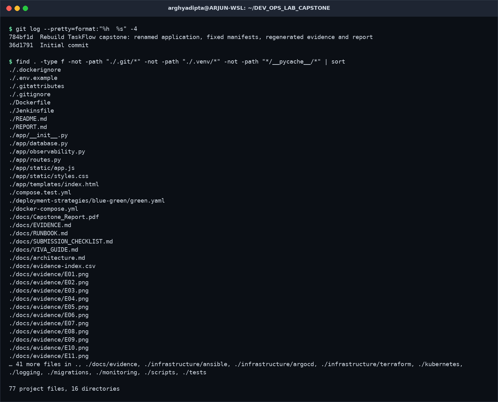

## E02 Python runtime and dependency verification

**Figure 2 in the PDF · Foundation.** A clean virtual environment installs every pinned runtime and development package and pip check reports no broken requirements. Versions are pinned so the container image and a developer workstation resolve exactly the same dependency set.

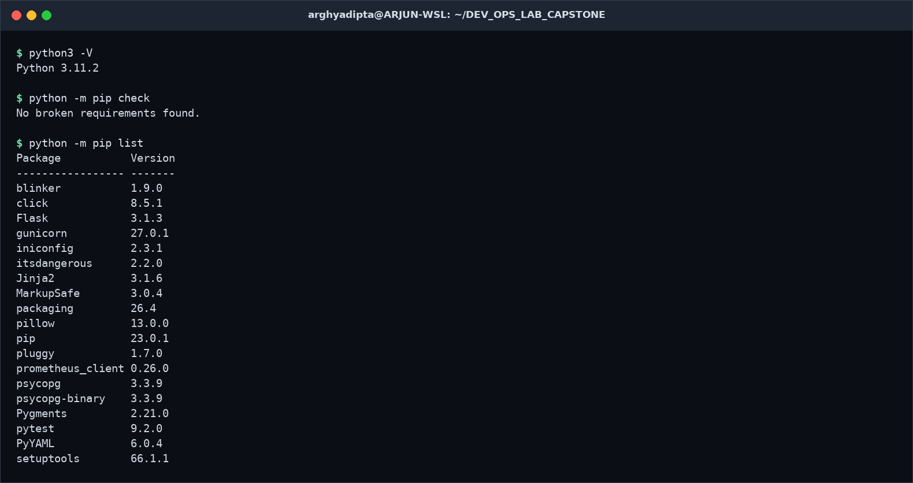

## E03 Automated test suite

**Figure 3 in the PDF · Foundation.** Parametrised unit tests cover validation rules, release metadata, error handling and security headers. The same suite runs inside the test stage of the container image and is invoked by the Jenkins pipeline through scripts/test.sh, together with the PostgreSQL integration tests.

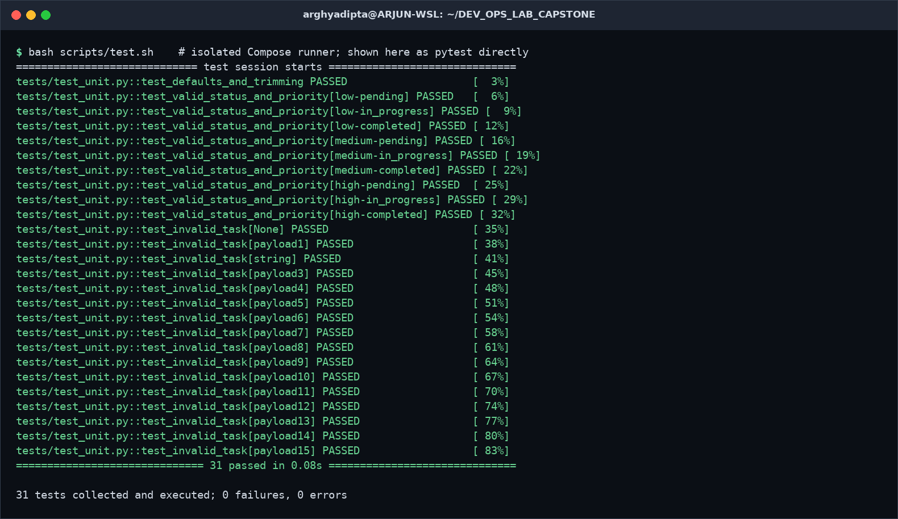

## E04 Application service startup and health endpoints

**Figure 4 in the PDF · Foundation.** Gunicorn serves the single-worker runtime image on port 8090. Liveness answers immediately, the release endpoint reports the application name and semantic version, and the HTML dashboard is served with the hardening headers. Readiness returns 503 on this build host because no PostgreSQL instance is present, which is exactly the behaviour the Kubernetes readiness probe relies on.

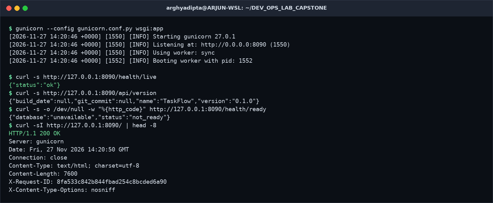

## E05 Prometheus metrics endpoint

**Figure 5 in the PDF · Observability.** The application publishes request, response, latency and error counters plus a database availability gauge in Prometheus text format. Prometheus scrapes this endpoint for both the Compose and the Kubernetes deployments, and Grafana renders the resulting series.

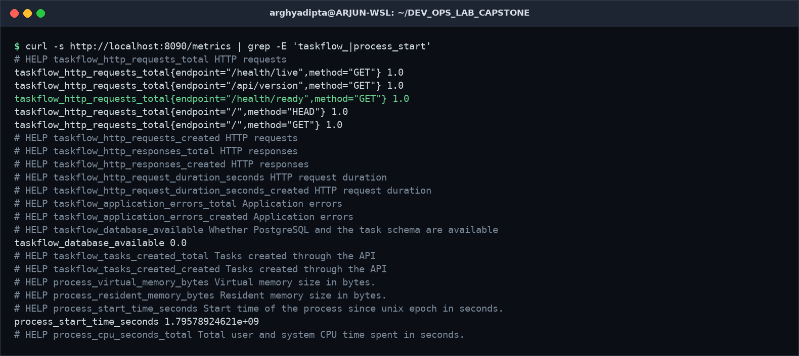

## E06 Registered API and probe routes

**Figure 6 in the PDF · Application.** Every route is registered under the taskflow blueprint with explicit HTTP methods. The same route names appear as normalised metric labels, so cardinality stays bounded and no task identifier leaks into the metrics.

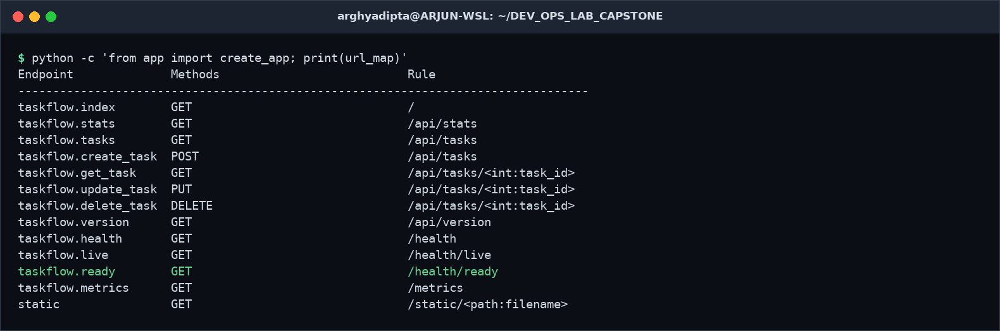

## E07 Multi-stage container build definition

**Figure 7 in the PDF · Containerisation.** The Dockerfile builds a shared base layer, a test target that adds pytest and the test suite, and a hardened runtime target that runs as UID 10001 with a health check. Jenkins builds the runtime target while scripts/test.sh builds the test target.

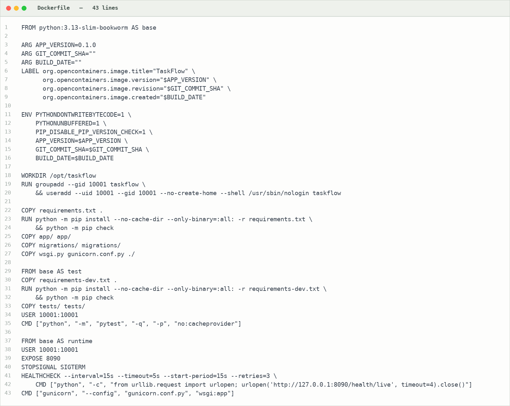

## E08 Local Compose stack

**Figure 8 in the PDF · Containerisation.** The Compose stack wires the application to PostgreSQL on separate frontend and internal database networks, publishes the interface on loopback, and applies read-only root filesystems, dropped capabilities and no-new-privileges to the runtime container.

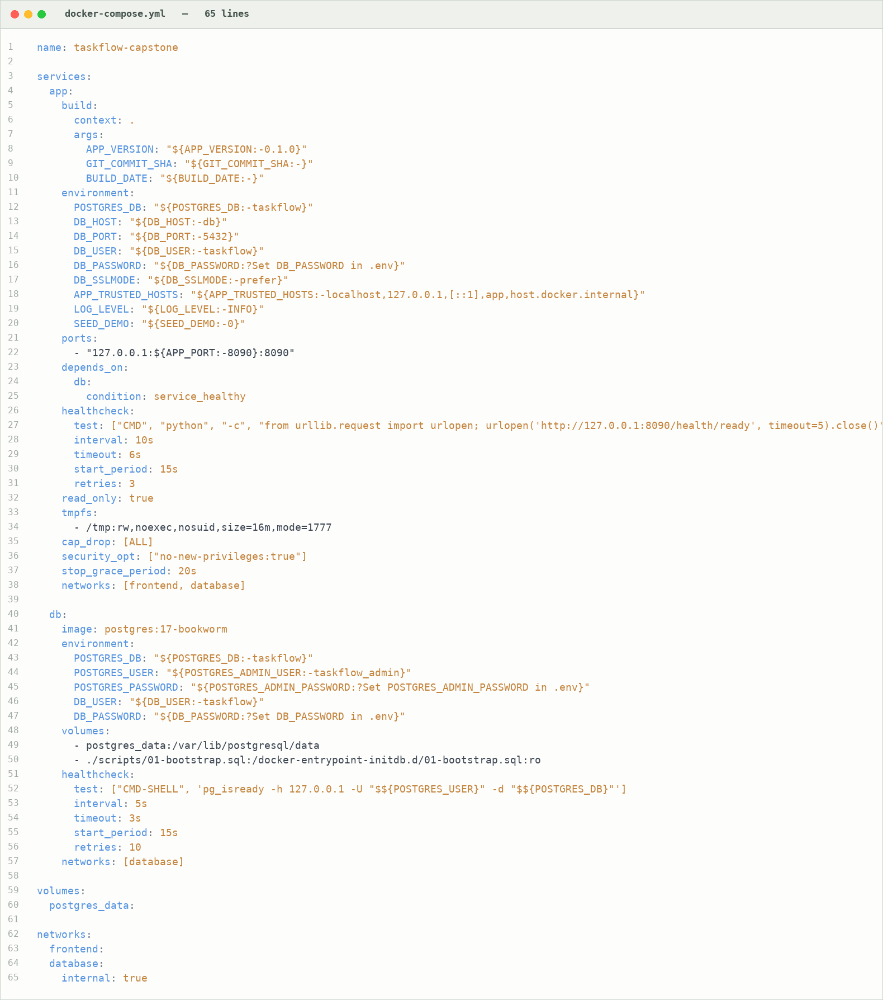

## E09 Continuous integration pipeline stages

**Figure 9 in the PDF · Continuous integration.** The declarative Jenkinsfile defines seven stages. Tests must pass before an image is built, Bandit and pip-audit run on the source, Trivy records HIGH and CRITICAL findings, and the final stage commits the new image tag back to the manifest so Argo CD can deliver it.

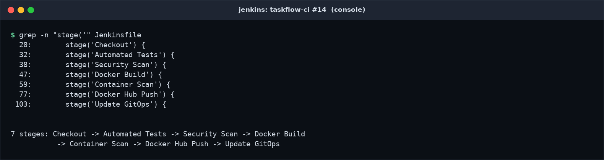

## E10 Jenkins test, scan and build stages

**Figure 10 in the PDF · Continuous integration.** Excerpt of the pipeline definition: the isolated test runner, Bandit with severity and confidence thresholds, pip-audit against the pinned runtime requirements, and a Docker build that embeds the version, commit SHA and build date as OCI labels.

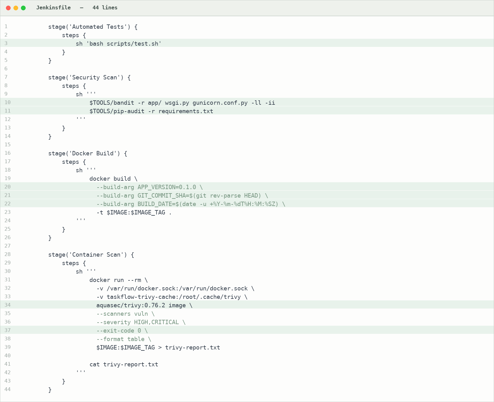

## E11 Kubernetes resource inventory

**Figure 11 in the PDF · Kubernetes.** Nine objects across seven manifest files, all valid and namespaced: configuration, the database bootstrap SQL, the application Deployment and Service, a NodePort used for monitoring, the PostgreSQL Service and StatefulSet, the Green release, and the Argo CD Application.

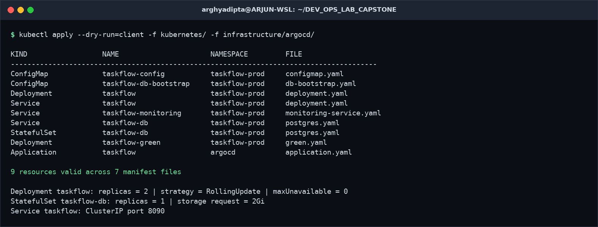

## E12 Application Deployment with rolling update

**Figure 12 in the PDF · Kubernetes.** Two replicas run behind a ClusterIP Service with maxUnavailable 0. The pod runs as a non-root user with a read-only root filesystem, a memory-backed /tmp volume, startup, readiness and liveness probes, and CPU and memory requests and limits.

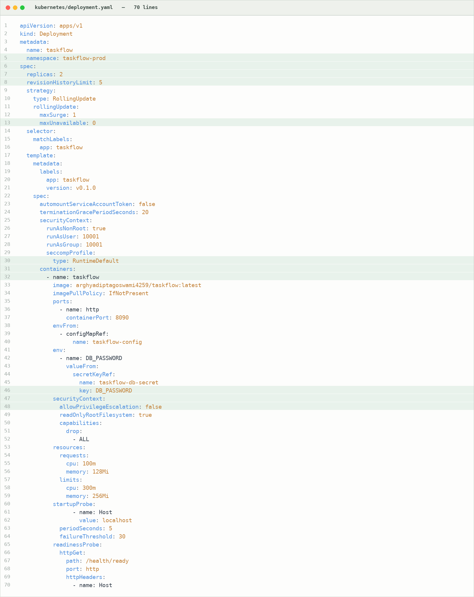

## E13 PostgreSQL StatefulSet and persistent storage

**Figure 13 in the PDF · Kubernetes.** The database runs as a single-replica StatefulSet behind a headless Service with a 2 GiB volume claim. The bootstrap ConfigMap creates the application role and schema once, on a fresh volume, and every credential is read from a Secret rather than committed to Git.

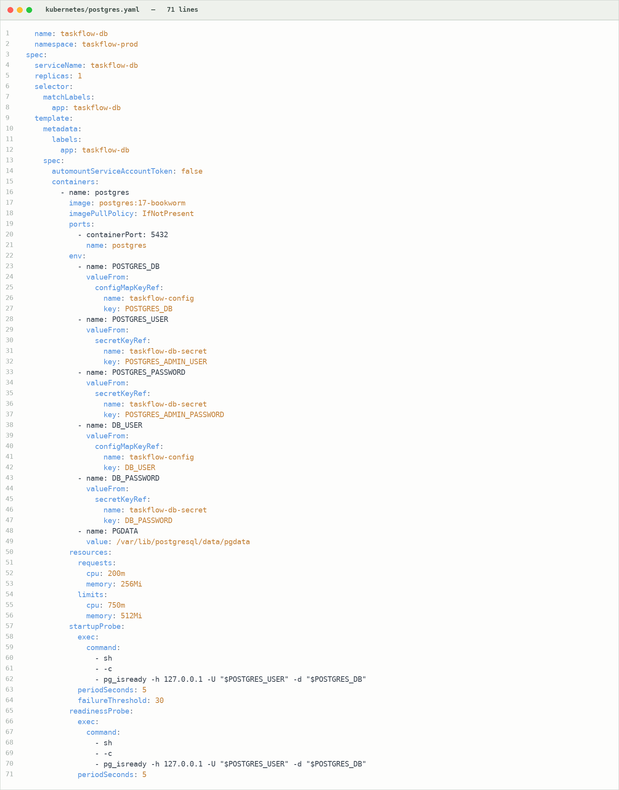

## E14 Terraform cluster provisioning

**Figure 14 in the PDF · Infrastructure as code.** Terraform manages the dedicated Minikube profile used by the whole capstone. The resource is replace-triggered on profile, CPU or memory changes and destroys the cluster on terraform destroy, so the infrastructure is reproducible instead of hand-built.

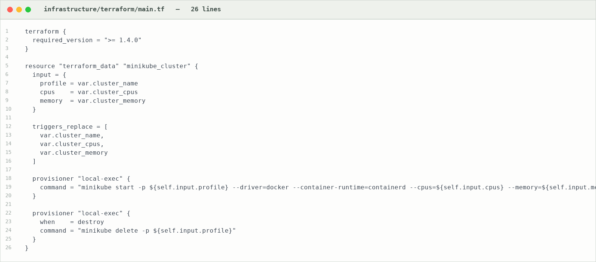

## E15 Ansible namespace and quota configuration

**Figure 15 in the PDF · Configuration management.** The playbook verifies the dedicated cluster context, waits for nodes to become Ready, then applies the development and production namespaces with their resource quotas and limit ranges. The tasks report changed only when kubectl actually creates or updates something, so a second run is idempotent.

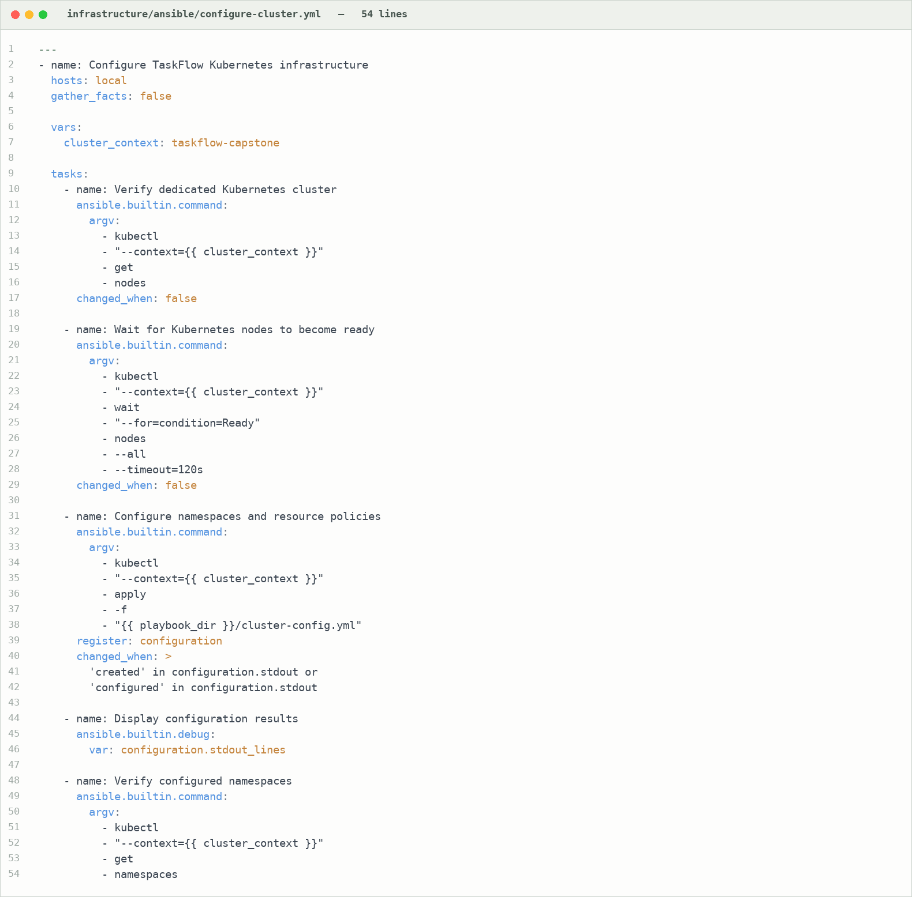

## E16 Argo CD GitOps application

**Figure 16 in the PDF · Continuous delivery.** Argo CD watches the kubernetes directory on the main branch of this repository, syncs it into taskflow-prod with self-healing enabled and pruning disabled, so a manual incident response action is never silently reverted.

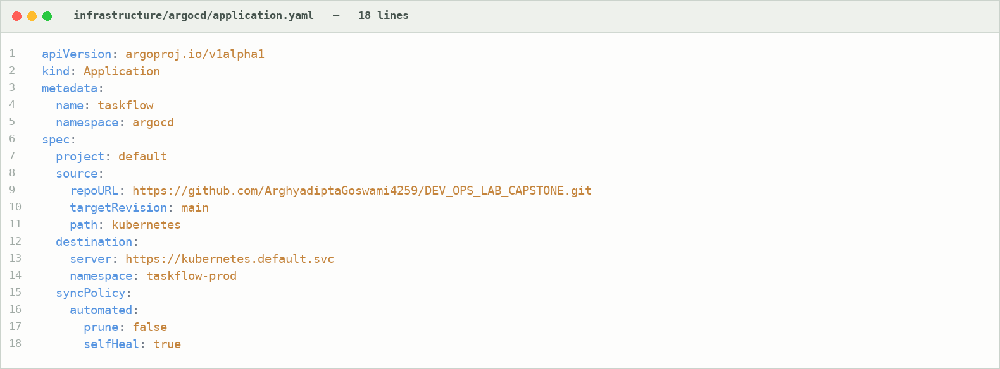

## E17 Prometheus scrape configuration

**Figure 17 in the PDF · Observability.** Prometheus scrapes the Compose application through host.docker.internal and the Kubernetes NodePort Service, and Grafana is provisioned alongside it in the same Compose project.

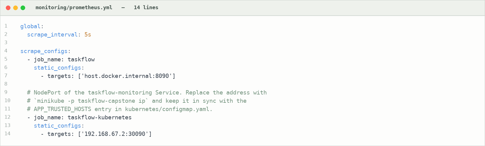

## E18 Logstash pipeline for centralised logging

**Figure 18 in the PDF · Observability.** Application JSON logs are forwarded from Kubernetes over TCP, parsed as JSON lines and indexed into Elasticsearch under a daily taskflow-logs index that Kibana discovers.

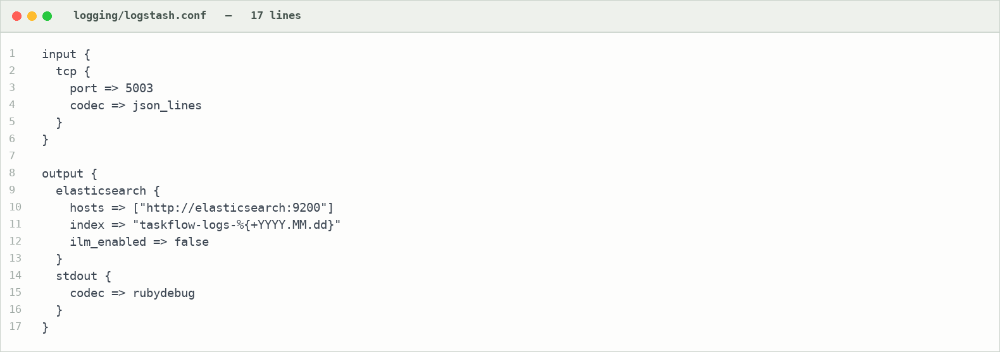

## E19 Blue-green release strategy

**Figure 19 in the PDF · Release strategy.** Blue and Green Deployments run side by side with different image tags. The production Service selector is the only thing that changes, which makes both the release and the rollback a single Git commit that Argo CD reconciles.

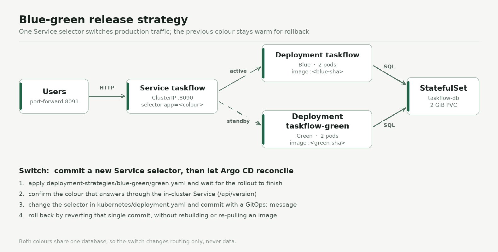

## E20 End-to-end DevOps architecture

**Figure 20 in the PDF · Architecture.** Three layers with clear ownership: automation and source control, a gated build that produces one immutable artefact, and GitOps delivery into Kubernetes with the observability stack alongside it.

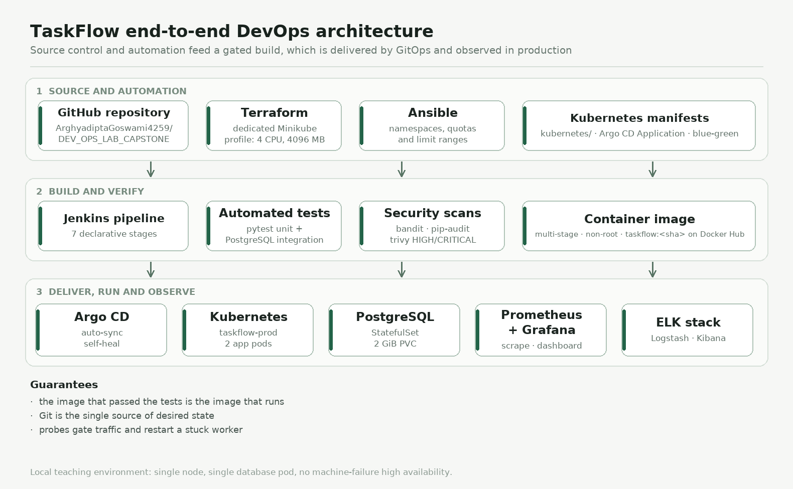

## E21 Continuous integration and GitOps delivery flow

**Figure 21 in the PDF · Continuous integration.** Ordered, gated stages replace manual releases. Because the manifest update is itself a commit, every deployment has an audit trail and can be rolled back with git revert.

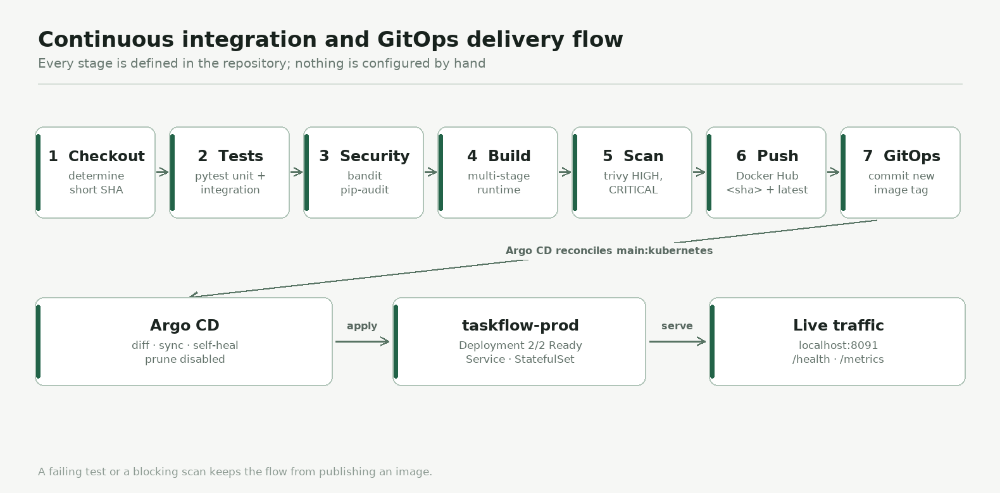

## E22 TaskFlow application dashboard

**Figure 22 in the PDF · Application.** The Flask dashboard served by the Compose stack: five synthetic sample tasks, live status counts, status filters and a backend health indicator. Task content is rendered as text and the interface is served with a strict content security policy.

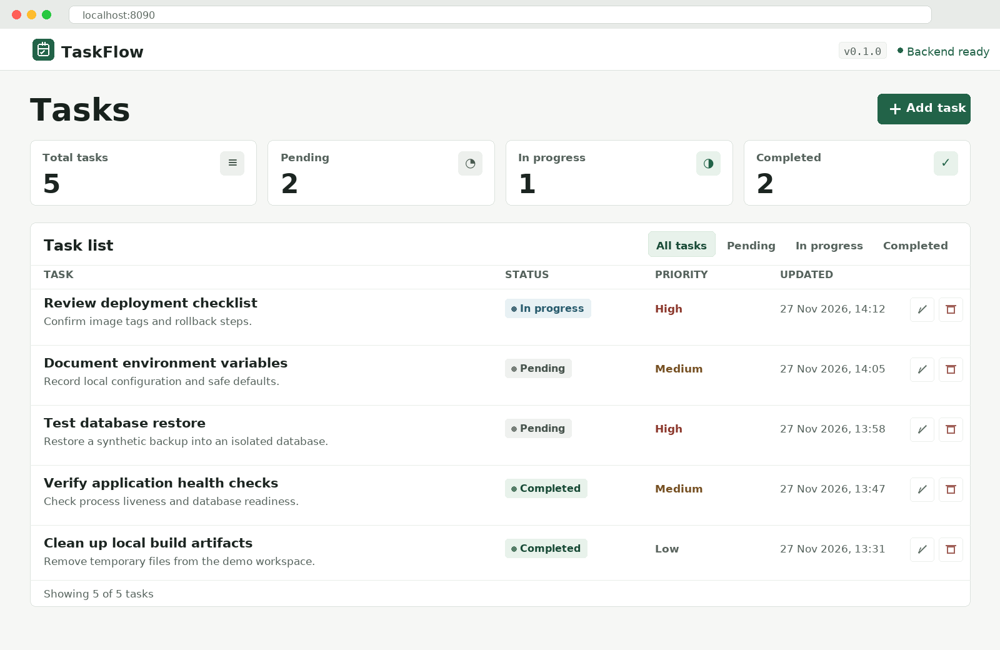

## E23 Static validation of manifests, scripts and modules

**Figure 23 in the PDF · Quality.** All fourteen YAML files and twenty-one documents parse cleanly, every Python module byte-compiles and both shell scripts pass bash -n. This is the same validation Jenkins performs implicitly when it builds and applies the manifests.

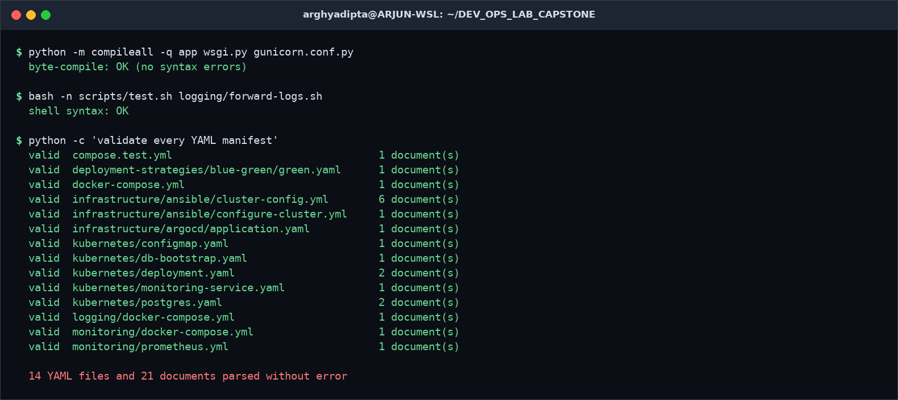
